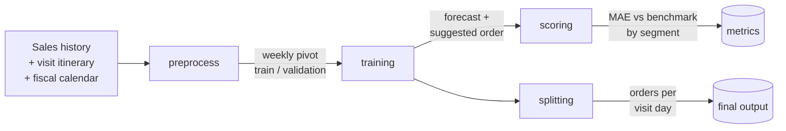

# Demand Forecasting & Suggested-Order Pipeline


A modular forecasting pipeline for **intermittent, high-cardinality demand**: weekly sales for tens of thousands of
`(branch, route, customer, product)` series, many of them with long runs of zeros. It produces a **suggested order**
per series for the next fiscal week and splits it across the planned **visit days**.

The project is built around three ideas:

1. **Ensemble per series.** Each series gets its own blend of a modified Croston-TSB model, off-the-shelf
   [Darts](https://unit8co.github.io/darts/) models and a stock-based regressor, with weights and hyperparameters
   chosen by backtesting on that series' own recent history.
2. **Business-aware output.** The statistical forecast is blended with a trend-based "ideal customer" signal to
   nudge orders upward for stable customers, controlled by two interpretable knobs.
3. **Production shape.** Each stage is a standalone script (`*_step.py`) that Azure ML chains into a pipeline;
   the logic lives in plain, unit-tested pandas functions.

> All data in this repository is synthetic. Domain-specific names have been generalised
> (branch / route / customer / product / units sold).

---

## Pipeline



| Stage | Code | What it does |
|---|---|---|
| **preprocess** | `model/preprocess/` | Cleans and filters sales, joins them with the visit itinerary and fiscal calendar, builds a weekly pivot (`W-THU`), removes unusable series, and routes the rest to *model* or *benchmark*. |
| **training** | `model/training/`, `model/auxiliar_func/models/` | Per-series hyperparameter/weight search, final forecast, stock-based forecast and suggested order. |
| **scoring** | `model/scoring/` | Offline evaluation: MAE of the model vs. a moving-average benchmark, segmented by customer volume. |
| **splitting** | `model/splitting/` | Distributes each weekly order across the visit days in the itinerary using historical day-of-week shares. |
| **orchestration** | `ml_service/`, `model/*/*_step.py` | Builds and publishes an Azure ML pipeline (`PythonScriptStep`s passing `PipelineData` between stages). |

---

## Technical walkthrough

### 1. Preprocessing (`preprocess_utils.data_process`)

- **Fiscal calendar.** Sales are aligned to a 52-week, 364-day fiscal year whose weeks start on a Thursday
  (`get_fiscal_calendar`), so weekly aggregation uses the `W-THU` frequency and week numbers cross year boundaries
  correctly (week 1 and 2 look back into the previous year).
- **Series identity.** `id_cols` are concatenated into a `unique_id` (`columns2unique_id`).
- **Filtering.** By channel, branch, route, customer and product (or `"all"`). Only customers that appear in the
  *target week's visit itinerary* and have history are kept; non-positive sales are removed from the sales pivot.
- **Series lifecycle rules** (all thresholds in `parameters.json`):
  - *recently added* — first sale within the last `recently_added_threshold` weeks → dropped (not enough history);
  - *ceased to exist* — last sale older than `ceased_to_exist_threshold` weeks → dropped;
  - *too short to model* — fewer than `benchmark_threshold` weeks of history → routed to the benchmark;
  - no sales in the last 8 weeks → dropped.
- **Outputs.** A weekly sales pivot (`unique_id × week`), a daily *returns* pivot kept for returns analysis, and a
  train / validation split on the last `benchmark` weeks.

### 2. Forecasting (`training_utils.fit_model`)

For every series, in parallel (`joblib`):

**a) Modified Croston-TSB** (`auxiliar_func/models/auxiliar_models/Croston/`).
Classic Croston–TSB models demand as `level × probability-of-demand`, updating the level only when demand occurs and
decaying the probability otherwise:

```
level[t+1] = α·y[t] + (1-α)·level[t]     if y[t] > 0     else level[t]
prob[t+1]  = β + (1-β)·prob[t]           if y[t] > 0     else (1-β)·prob[t]
forecast   = prob · level
```

The modified version (i) initialises the probability from the first observed demand, (ii) rounds small forecasts to
zero using a threshold derived from the series' share of non-zero weeks, and (iii) recursively extends the series for
multi-step forecasts by reusing past values when a recent value has a historical "twin". `(α, β)` are tuned per series
over a 9×9 grid by minimising MAE on the validation window.

**b) Darts models.** Any list of Darts forecasters (the examples use `KalmanForecaster` and `Croston(version="sba")`;
the step scripts also import ARIMA, ExponentialSmoothing, FFT, LightGBM, RandomForest, StatsForecastAutoARIMA).

**c) Per-series ensemble weights.** Predictions of all models on the validation window are combined with every
weight vector from `product(weights, repeat = n_models + 1)`, normalised, and scored by MAE. The best vector is kept
for that series (`search_weights`), then models are refit on the full history and blended with those weights.

**d) Stock-based forecast** (`auxiliar_func/models/auxiliar_models/stock/`).
Estimates the *unobserved inventory* a customer holds before each delivery: after a delivery of `q` units, a
fraction `pct_sale` of `q` is assumed sold each week, so remaining stock decays; when two deliveries are adjacent
the next delivery is compared to the previous stock. "Normal stock" = estimated stock + units delivered. A linear
regression of next-period sales on normal stock produces a second forecast, and `pct_sale` is picked per series by
grid search on the validation window.

The statistical and stock-based forecasts are averaged to give the **final forecast**.

### 3. Suggested order (`auxiliar_func/models/auxiliar_models/suggested/`)

A trend signal is computed per series: a linear regression on the last `tendency_window` non-zero weeks.
Series are classified by slope (`uptrend` > 1, `stable` in [0, 1], `downtrend` otherwise). For up/stable series the
signal is the average of the extrapolated trend and the historical maximum; for down-trending series it uses a
"perfect customer" slope learned as the mean slope of stable series that start from a similar level.

```
suggested = (prediction_importance · forecast + sales_increase_importance · trend_signal)
            / (prediction_importance + sales_increase_importance)
```

With `0.7 / 0.3` the order is the forecast, nudged toward growth. Both weights are plain business parameters in
`parameters.json`.

### 4. Scoring (`scoring_utils.scoring`)

Compares the model against a **benchmark** (mean of the last `benchmark` weeks) on a hold-out window. Series are
segmented by mean non-zero weekly volume — `(0, 5]`, `(5, 8]`, `(8, max]` — and mean / median MAE are reported per
segment and globally, because intermittent-demand errors are dominated by the high-volume tail.

### 5. Splitting (`splitting_utils.split`)

A weekly order has to be delivered on specific days. For each series the historical share of volume per day-of-cycle
(`Frac`) is computed; the order is distributed with `rint(order · Frac)` on each planned visit, and the rounding
remainder is assigned to a randomly chosen visit so the **weekly total is preserved exactly**.

---

## Repository layout

```
model/
  preprocess/  training/  scoring/  splitting/     # *_utils.py (pure logic) + *_step.py (Azure ML entry points)
  auxiliar_func/
    models/auxiliar_models/{Croston,stock,suggested,altered_Croston_TSB}/
    returns/                                       # returns-rate analysis helpers
  parameters.json                                  # every tunable lives here
ml_service/                                        # Azure ML workspace / compute / environment / pipeline builder
tests/                                             # pytest, synthetic data only
examples/run_demo.py                               # end-to-end demo on synthetic data
```

## Running it

```bash
pip install -r requirements.txt
pytest                         # unit tests on synthetic data
python examples/run_demo.py    # forecast → suggested order → scoring on generated series
```

To publish the Azure ML pipeline: `pip install -r requirements-azureml.txt`, set the environment variables read in
`ml_service/util/env_variables.py` (workspace, resource group, compute, datastore…), then run
`python -m ml_service.pipelines.build_train_pipeline`.

## Configuration (`model/parameters.json`)

| Key | Meaning |
|---|---|
| `week`, `year` | Target fiscal week to forecast |
| `freq` | Aggregation frequency (`W-THU`) |
| `recently_added_threshold`, `ceased_to_exist_threshold`, `benchmark_threshold` | Series lifecycle rules (weeks) |
| `benchmark` / `validation_window` | Weeks held out for validation and scoring |
| `weights` | Grid of ensemble weights searched per series |
| `pct_sales` | Grid of sell-through rates for the stock model |
| `tendency_window` | Weeks used for the trend regression |
| `prediction_importance`, `sales_increase_importance` | Blend between forecast and growth signal |

## Design notes & limitations

- Per-series model selection is embarrassingly parallel (`joblib`), but the weight grid grows as
  `len(weights)^(n_models+1)`; keep the model list short or the grid coarse.
- The stock model is a heuristic; it assumes sell-through is roughly proportional to the delivered quantity.
- Randomised remainder assignment in the splitter makes the per-day split non-deterministic (totals are not).
- The code targets the Darts 0.20 / pandas 1.x API generation (see `requirements.txt`).
